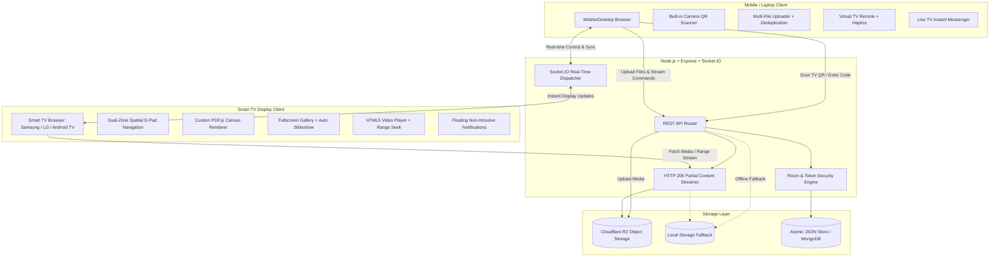

# ScreenRoom — Smart TV Wireless File Sharing, Gallery & Document Viewer

> **ScreenRoom** is a production-grade, room-based wireless file sharing, photo/video gallery, and document presentation web application designed for Smart TVs, mobile phones, tablets, and laptops.
> 
> Unlike traditional AirPlay, Miracast, or Chromecast setups, ScreenRoom **works across the public internet**—your Smart TV and mobile phone can be on completely different Wi-Fi networks, mobile data (4G/5G), or different geographical locations.

---

## Architecture Overview



---

## Key Features & Capabilities

### 1. Smart TV Display Mode (`/tv`)
- **10-Foot Lean-Back Interface:** Tailored for viewing from living room distances (3–5 meters) with ultra-high contrast dark aesthetics, large legible typography, and vibrant glowing focus states.
- **Instant Pairing Screen:** Displays an oversized high-density QR code with a human-friendly 4-character room code (`0`, `O`, `1`, `I`, `L` excluded to avoid ambiguity).
- **Persistent Room Session:** Remembers room session tokens in browser storage across TV reboots and page refreshes—no accidental disconnection if the TV browser sleeps.
- **Dual-Zone Spatial D-Pad Remote Navigation:** Full spatial navigation across Category Tabs (`All`, `Images`, `Videos`, `Documents`) and Grid Cards with hardware debouncing to eliminate duplicate IR clicks.
- **Floating Live Notifications:** Toast messages and chat notes float gracefully in the top-right corner without disrupting fullscreen video or document presentations.

### 2. High-Fidelity Media Viewers
- **Custom PDF.js Canvas Renderer:** Compiles and renders vector PDF pages directly onto an HTML5 `<canvas>` element using `pdfjs-dist`. Eliminates dependencies on native TV browser PDF plugins that frequently crash on Smart TVs. Supports Page Turning (`Prev/Next`), Zoom Presets (`1x`, `1.5x`, `2x`, `Fit Width`, `Fit Page`), up to 300% zoom, and vertical D-pad pan scrolling.
- **Fullscreen Image Gallery:** Preserves true aspect ratio with dynamic smooth transitions, multiple zoom levels (`1x`, `2x`, custom zoom in/out, fit to screen), and an automated slideshow mode with configurable intervals (`Space`).
- **HTML5 Video Player with HTTP 206 Streaming:** True byte-range partial content streaming (`Accept-Ranges: bytes`) allows instantaneous scrubbing and seeking through heavy high-definition video files. Includes custom playback rates (`1x`, `1.5x`, `2x`), loop controls, and volume control.

### 3. Mobile & Desktop Controller
- **In-Browser Camera QR Scanner:** Directly scans the TV QR code using the device camera (`html5-qrcode`) with real-time video preview, camera switching (front/back), and instant auto-connect.
- **Bidirectional Connection Flow:**
  - **TV First:** TV launches room $\rightarrow$ Mobile scans QR code or enters 4-character code.
  - **Mobile First:** Mobile creates room $\rightarrow$ TV goes to `/tv` and enters room code via on-screen D-pad keypad or directly loads `/tv/<ROOM_CODE>`.
- **Duplicate File Detection:** Client computes file fingerprints (name + size + last modified) to detect duplicate uploads before uploading, preventing wasted bandwidth and cluttered TV galleries.
- **Virtual TV Remote Controller:** Turns mobile device into a dedicated Smart TV remote with tactile haptic feedback (`navigator.vibrate`):
  - D-pad Arrow controls (`Up`, `Down`, `Left`, `Right`)
  - `OK / Enter` action
  - `Back` button
  - `Zoom In (+)` and `Zoom Out (-)`
  - `1:1 (Original Scale)` reset
- **Real-Time Live Messaging:** Instantly cast quick notes, meeting agendas, presentation remarks, or comments directly onto the big screen.

---

## Smart TV Remote Control Compatibility Guide

Smart TV remotes vary widely across manufacturers (Samsung One Remote, LG Magic Remote, Sony BRAVIA, Fire TV, Android TV). Many modern remotes omit numeric buttons and physical `+` / `-` keys.

ScreenRoom solves this with 3 complementary control mechanisms:

| Remote Button | Gallery Action | PDF Document Action | Video Player Action |
| :--- | :--- | :--- | :--- |
| `▲` (Up Arrow) | Navigate cards up | Pan zoomed page up / Prev item | Increase volume |
| `▼` (Down Arrow) | Navigate cards down | Pan zoomed page down / Next item | Decrease volume |
| `◀` (Left Arrow) | Navigate cards left | Previous Page | Rewind 10 seconds |
| `▶` (Right Arrow) | Navigate cards right | Next Page | Fast Forward 10 seconds |
| `ENTER / OK` | Open focused item | Toggle zoom preset | Toggle Play / Pause |
| `BACK / RETURN` | Return to top / Exit | Exit PDF viewer | Exit Video player |
| `SPACE` | Start/Pause Slideshow | Start Slideshow | Toggle Play / Pause |
| `+` / `-` (if present) | Zoom in / Zoom out | Zoom in / Zoom out | Volume up / down |
| **On-Screen Buttons** | Clickable navigation pills | Focused `[Zoom +]`, `[Zoom -]`, `[100% Fit]` | On-screen transport bar |
| **Mobile Virtual Remote**| Instant touch D-pad | Direct Zoom In / Zoom Out touch buttons | Play, Pause, Next, Prev |

---

## Storage Architecture & Cloudflare R2 Integration

ScreenRoom implements a **Cloud-Native Hybrid Storage Engine**:

1. **Cloudflare R2 Object Storage (Zero Egress Fees):**
   - High-throughput S3-compatible cloud storage powered by Cloudflare's global edge network.
   - Configured through `@aws-sdk/client-s3` with automatic region negotiation (`region: 'auto'`).
   - Objects are stored securely and streamed via signed/proxied HTTP endpoints.
2. **Graceful Zero-Configuration Fallback:**
   - If Cloudflare R2 credentials are not provided or if the remote bucket is temporarily unreachable, ScreenRoom automatically stores files in `server/uploads/` with zero crashes or downtime.
3. **HTTP 206 Partial Content Streaming:**
   - Video and audio files are served with proper `Content-Range`, `Content-Length`, and `Accept-Ranges: bytes` headers, allowing Smart TV media engines to buffer smoothly without downloading entire files upfront.

---

## Security & Secrets Protection

> [!IMPORTANT]
> **NEVER COMMIT YOUR `.env` FILES OR API CREDENTIALS TO VERSION CONTROL!**
> 
> The project includes pre-configured `.gitignore` files at the root, client, and server directories to safeguard all private keys, Cloudflare R2 tokens, and uploaded media files.

### Protected by `.gitignore`:
- `.env`, `.env.local`, `.env.*.local` (Cloudflare tokens, MongoDB credentials, API keys)
- `node_modules/` (Dependencies)
- `server/uploads/*` (All user-uploaded photos, videos, and PDFs)
- `server/data/*` (Local room database state)
- `dist/`, `client/dist/` (Production build artifacts)
- `*.log` (Debug logs)

---

## Directory Structure

```
tv-file-share-and-show/
├── .env.example                 # Safe environment variables template
├── .gitignore                   # Root git protection (blocks .env, uploads, node_modules)
├── package.json                 # Monorepo runner scripts
├── README.md                    # Project documentation & architecture
│
├── client/                      # Frontend SPA (React 18 + Vite + Tailwind CSS)
│   ├── .env.example             # Frontend environment variables template
│   ├── .gitignore               # Frontend gitignore
│   ├── index.html               # Main HTML entrypoint
│   ├── vercel.json              # Vercel SPA routing configuration
│   ├── vite.config.js           # Vite development server configuration
│   └── src/
│       ├── api/apiClient.js     # Unified REST API client with progress tracking
│       ├── components/
│       │   ├── gallery/         # Fullscreen Image Viewer with zoom & slideshow
│       │   ├── messages/        # Live TV message drawer & suggestion chips
│       │   ├── mobile/          # Virtual TV Remote & Recent Rooms cards
│       │   ├── pdf/             # Custom PDF.js Canvas document viewer
│       │   ├── qr/              # Built-in camera QR scanner & QR generator
│       │   ├── tv/              # 10-ft TV components (cards, tabs, remote hints)
│       │   ├── upload/          # Multi-file dropzone & duplicate detection modal
│       │   └── video/           # HTML5 video player with playback speeds
│       ├── context/
│       │   ├── RoomContext.jsx  # Socket.IO sync, state, pairing persistence
│       │   └── ToastContext.jsx # Toast alert system
│       ├── hooks/
│       │   └── useTVNavigation.js # Spatial D-pad remote navigation with debounce
│       └── pages/
│           ├── Home.jsx         # Mobile landing screen with QR scan & saved rooms
│           ├── TVDisplay.jsx    # Dedicated Smart TV display & gallery
│           ├── RoomDashboard.jsx# Mobile management dashboard & remote
│           ├── JoinRoom.jsx     # Manual 4-character code entry
│           └── CreateRoom.jsx   # Mobile room creation
│
└── server/                      # Backend Server (Node.js + Express + Socket.IO)
    ├── .env.example             # Server environment variables template
    ├── .gitignore               # Server gitignore
    ├── server.js                # Express & Socket.IO server entrypoint
    ├── test-e2e.js              # Automated 20-scenario end-to-end test suite
    ├── test-r2.js               # Cloudflare R2 connectivity diagnostic tool
    ├── config/db.js             # Dual-engine persistence (MongoDB + Disk Fallback)
    ├── controllers/             # Room, Upload, and Message controllers
    ├── middleware/              # Rate limiters & Multer sanitization
    ├── models/RoomSchema.js     # Mongoose schema for rooms & files
    ├── services/
    │   ├── r2Storage.js         # Cloudflare R2 AWS S3 SDK v3 integration
    │   └── roomStore.js         # Atomic JSON persistence service
    ├── sockets/socketHandler.js # Real-time WebSockets & TV remote commands
    ├── uploads/                 # Local uploaded media storage (.gitkeep preserved)
    └── data/                    # Local persistent database store (.gitkeep preserved)
```

---

## Local Development & Setup

### Prerequisites
- **Node.js**: v18.0.0 or higher (Tested on Node v24)
- **npm**: v9.0.0 or higher

### 1. Installation
In the root directory, install all dependencies:
```bash
# Install backend dependencies
cd server
npm install

# Install frontend dependencies
cd ../client
npm install
```

### 2. Environment Configuration
Create a `.env` file in the `server/` directory by copying `server/.env.example`:
```bash
cp server/.env.example server/.env
```

Configure your parameters:
```env
PORT=5000
NODE_ENV=development
CLIENT_URL=http://localhost:3000
UPLOAD_MAX_SIZE_MB=250

# Optional MongoDB URI (falls back to atomic JSON store at server/data/rooms.json if empty)
# MONGO_URI=mongodb://localhost:27017/screenroom

# Cloudflare R2 Object Storage Credentials
R2_ACCOUNT_ID=your_cloudflare_account_id_here
R2_BUCKET_NAME=screentv
R2_ACCESS_KEY_ID=your_r2_access_key_id_here
R2_SECRET_ACCESS_KEY=your_r2_secret_access_key_here
```

### 3. Running Locally

#### Development Mode (Frontend HMR + Backend):
```bash
# Terminal 1: Start Backend Server (Port 5000)
cd server
npm start

# Terminal 2: Start Frontend with Vite (Port 3000)
cd client
npm run dev
```
- Open Mobile / Laptop Controller: `http://localhost:3000`
- Open Smart TV Interface: `http://localhost:3000/tv`

#### Production Mode (Single Unified Port 5000):
```bash
# 1. Build Client
cd client
npm run build

# 2. Start Unified Server
cd ../server
npm start
```
- Access everything on `http://localhost:5000` and `http://localhost:5000/tv`.

---

## Automated Verification & Tests

### End-to-End Test Suite
Run the 20-scenario automated acceptance test:
```bash
node server/test-e2e.js
```
Verifies:
- ✅ API Health & Room Creation (4-character ambiguous character filtering)
- ✅ Cryptographic pairing token generation & case-insensitive lookup
- ✅ TV & Mobile auto-reconnect validation
- ✅ Multi-file upload classification (Images, Videos, PDFs)
- ✅ Duplicate file upload detection & rejection
- ✅ HTTP 206 Partial Content Range streaming
- ✅ File renaming, versioning & deletion
- ✅ Real-time message dispatching & activity timeline logging

### Cloudflare R2 Storage Test
Verify your Cloudflare R2 connection:
```bash
node server/test-r2.js
```

---

## Production Deployment Guide

### Option 1: Frontend on Vercel + Backend on Render / Railway

#### A. Deploy Frontend to Vercel:
1. Push your repository to GitHub (ensure `.gitignore` is present).
2. Import the project in Vercel:
   - **Root Directory**: `client`
   - **Framework Preset**: `Vite`
   - **Build Command**: `npm run build`
   - **Output Directory**: `dist`
3. Add Environment Variable in Vercel Project Settings:
   - `VITE_BACKEND_URL`: `https://your-backend-app.onrender.com`
4. The included `client/vercel.json` automatically handles client-side SPA routing (`/tv`, `/room/:code`, etc.).

#### B. Deploy Backend to Render / Railway:
1. Create a **Web Service** pointing to the `server/` directory:
   - **Build Command**: `npm install`
   - **Start Command**: `node server.js`
2. Add Environment Variables:
   - `PORT`: `5000` (or leave default assigned by host)
   - `NODE_ENV`: `production`
   - `CLIENT_URL`: `https://your-frontend-domain.vercel.app`
   - `R2_ACCOUNT_ID`: Your Cloudflare Account ID
   - `R2_BUCKET_NAME`: `screentv`
   - `R2_ACCESS_KEY_ID`: Your R2 S3 Access Key ID
   - `R2_SECRET_ACCESS_KEY`: Your R2 S3 Secret Access Key
3. Enable persistent disk (optional, only if using local storage fallback without R2).

---

## Connecting Your Smart TV

1. On your Smart TV (Samsung, LG, Sony, Fire TV), launch the web browser.
2. Navigate to your deployed ScreenRoom TV URL (e.g., `https://your-domain.vercel.app/tv`).
3. Press **Add to Bookmarks** or **Add to Home Screen** for fast future access.
4. Scan the on-screen QR code with your phone or enter the 4-character room code to start sharing immediately!

---

## License

MIT License © 2026 ScreenRoom. Designed for seamless, cross-platform wireless presentation.
